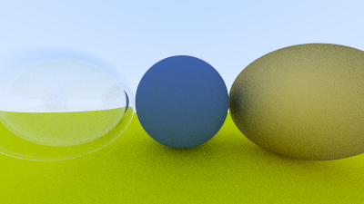

# BuildingMyFirstRenderer

A Monte Carlo path tracer in C++17, written from scratch while working through
[*Ray Tracing in One Weekend*](https://raytracing.github.io/) by Peter Shirley, Trevor David Black and Steve Hollasch.
About 600 lines, header-only, no external dependencies.



*400 × 225, 100 samples per pixel, up to 50 bounces. Left: hollow glass sphere. Centre: diffuse. Right: rough metal.
There is no lamp in the scene: all light comes from the sky gradient.*

## Features

- Ray–sphere intersection behind an abstract `hittable` interface, with closest-hit search over a scene list
- Antialiasing by random sampling inside each pixel (Monte Carlo integration)
- Materials
  - Lambertian (diffuse)
  - Metal with adjustable roughness (`fuzz`)
  - Dielectric (glass) with refraction, total internal reflection and Schlick's approximation for Fresnel reflectance
- Recursive path tracing with a maximum bounce depth
- Gamma correction and PPM image output

## Build and run

**Visual Studio (Windows):** open `BuildingMyFirstRenderer.slnx`, select **Release | x64**, and build.
The program writes the image to standard output, so run it from a terminal and redirect the output to a file:

```
BuildingMyFirstRenderer.exe > image.ppm
```

**g++ / clang (any platform):**

```
g++ -std=c++17 -O2 BuildingMyFirstRenderer/BuildingMyFirstRenderer.cpp -o renderer
./renderer > image.ppm
```

Progress is printed to standard error. PPM files open in GIMP, IrfanView, or most image viewers.

## Code structure

```
BuildingMyFirstRenderer/
├── BuildingMyFirstRenderer.cpp   builds the scene, sets up the camera, calls render()
└── Headers/
    ├── general.h        shared includes, constants, random numbers
    ├── vec3.h           3D vector used for points, directions and colours
    ├── ray.h            ray P(t) = origin + t · direction
    ├── interval.h       [min, max] range used for valid hit distances
    ├── color.h          gamma correction and PPM output
    ├── hittable.h       abstract interface for anything a ray can hit, plus hit_record
    ├── sphere.h         sphere intersection
    ├── hittable_list.h  a list of hittables (the scene), returns the closest hit
    ├── material.h       lambertian, metal, dielectric
    └── camera.h         viewport, pixel loop, antialiasing, ray_color
```

## Notes

[`NOTES.md`](NOTES.md) contains my working notes: the maths behind the camera model, ray–sphere intersection,
surface normals, the hittable design and Monte Carlo antialiasing, plus the C++ details I had to learn along the way.

## Roadmap

- [x] *Ray Tracing in One Weekend*: up to dielectric materials
- [ ] Positionable camera and defocus blur (depth of field)
- [ ] *Ray Tracing: The Next Week*: BVH acceleration, textures, quads, area lights, Cornell box
- [ ] *Ray Tracing: The Rest of Your Life*: importance sampling, direct light sampling, mixture PDFs
- [ ] Convergence study: error versus samples per pixel, with code and data in `experiments/`

## Acknowledgements

Based on the [Ray Tracing in One Weekend](https://raytracing.github.io/) series.
