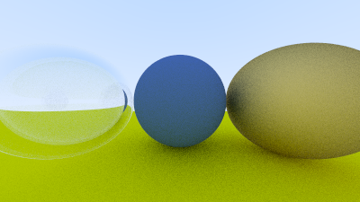
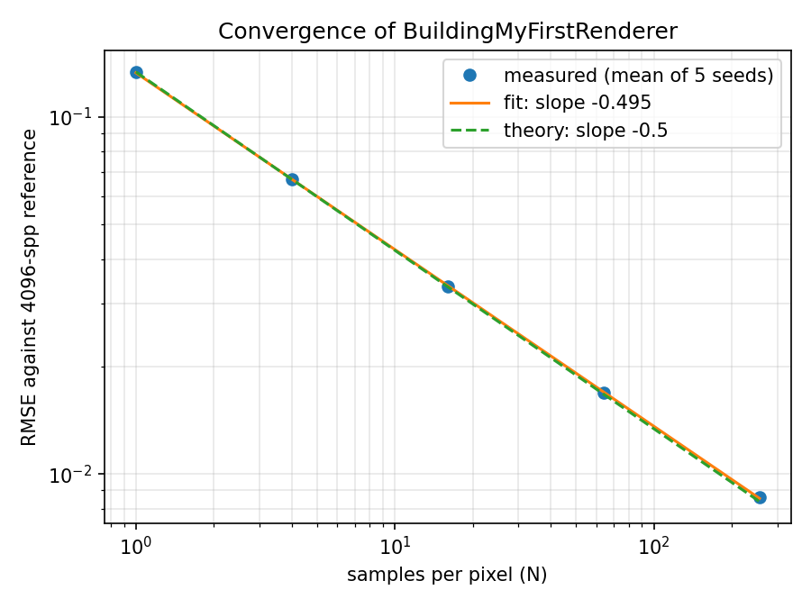
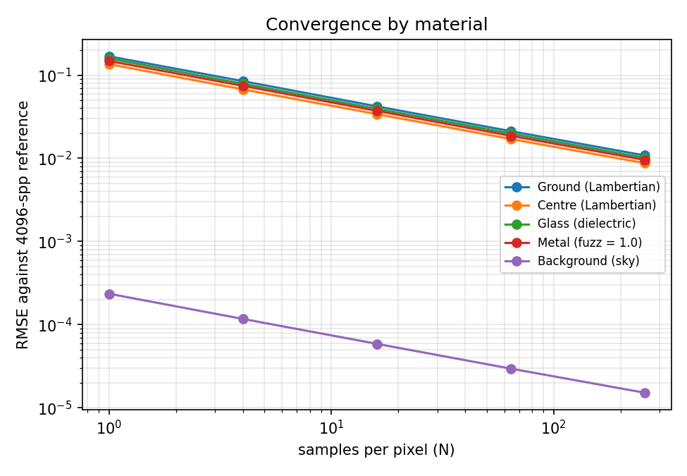

# BuildingMyFirstRenderer

A Monte Carlo path tracer in C++17, written from scratch while working through
[*Ray Tracing in One Weekend*](https://raytracing.github.io/) by Peter Shirley, Trevor David Black and Steve Hollasch.
About 700 lines, header-only, no external dependencies.



*400 × 225, 100 samples per pixel, up to 50 bounces. Left: hollow glass sphere. Centre: diffuse. Right: rough metal.
There is no lamp in the scene: all light comes from the sky gradient.*

## Features

- Ray–sphere intersection behind an abstract `hittable` interface, with closest-hit search over a scene list
- Antialiasing by random sampling inside each pixel (Monte Carlo integration)
- Materials
  - Lambertian (diffuse)
  - Metal with adjustable roughness (`fuzz`)
  - Dielectric (glass) with refraction, total internal reflection and Schlick's approximation for Fresnel reflectance
- Recursive path tracing with a maximum bounce depth
- Gamma correction and PPM image output

## Build and run

**Visual Studio (Windows):** open `BuildingMyFirstRenderer.slnx`, select **Release | x64**, and build.
The program writes the image to standard output, so run it from a terminal and redirect the output to a file:

```
BuildingMyFirstRenderer.exe > image.ppm
```

**g++ / clang (any platform):**

```
g++ -std=c++17 -O2 BuildingMyFirstRenderer/BuildingMyFirstRenderer.cpp -o renderer
./renderer > image.ppm
```

Progress is printed to standard error. PPM files open in GIMP, IrfanView, or most image viewers.

## Code structure

```
BuildingMyFirstRenderer/
├── BuildingMyFirstRenderer.cpp   builds the scene, sets up the camera, calls render()
└── Headers/
    ├── general.h        shared includes, constants, random numbers
    ├── vec3.h           3D vector used for points, directions and colours
    ├── ray.h            ray P(t) = origin + t · direction
    ├── interval.h       [min, max] range used for valid hit distances
    ├── color.h          gamma correction and PPM output
    ├── hittable.h       abstract interface for anything a ray can hit, plus hit_record
    ├── sphere.h         sphere intersection
    ├── hittable_list.h  a list of hittables (the scene), returns the closest hit
    ├── material.h       lambertian, metal, dielectric
    └── camera.h         viewport, pixel loop, antialiasing, ray_color
```

## Experiment: convergence study

How fast does the image error fall as samples per pixel increase? Monte Carlo theory predicts
RMSE = C / √N: four times the samples should halve the error. I measured this on the scene above.

**Method.** The renderer saves linear colour as 32-bit floats before gamma correction and 8-bit rounding,
so the measurement isn't limited by output precision. A reference was rendered at 4096 samples per pixel.
For N = 1, 4, 16, 64 and 256, five renders with different random seeds were compared against it.
For the per-material results, each pixel is labelled by the object its centre ray hits, and pixels within
3 pixels of an object's edge are excluded, since their samples mix two materials.

**Result.** The whole-image error follows the theory: fitted slope −0.495 (theory −0.5), R² = 0.99995.
The spread between the five seeds is below 0.4% of the mean at every N.

| Region | N = 1 | 4 | 16 | 64 | 256 | slope | C |
|---|---|---|---|---|---|---|---|
| Ground (Lambertian) | 0.1684 | 0.0847 | 0.0421 | 0.0212 | 0.0109 | −0.495 | 0.168 |
| Centre (Lambertian) | 0.1357 | 0.0674 | 0.0341 | 0.0171 | 0.0088 | −0.494 | 0.135 |
| Glass (dielectric) | 0.1586 | 0.0788 | 0.0393 | 0.0199 | 0.0101 | −0.496 | 0.157 |
| Metal (fuzz = 1.0) | 0.1479 | 0.0743 | 0.0372 | 0.0187 | 0.0096 | −0.494 | 0.147 |
| Background (sky) | 0.00024 | 0.00012 | 0.00006 | 0.00003 | 0.00002 | −0.494 | 0.0002 |

<p>


</p>

**What it shows.** Every material converges at the same rate; only the constant C differs. The slope comes
from averaging random samples and can't be improved. C depends on how much individual samples differ from
each other, which depends on how well rays are aimed at where the light comes from. So for a fixed time
budget, image quality can only improve through better sampling, not more of the same.

The slope is slightly flatter than −0.5 because the 4096-sample reference has a small error of its own
(about 0.002), which matters most at N = 256.

**Reproduce it** (Windows, after a Release build):

```
cd experiments
run_convergence.bat
python analyze.py
python analyze_materials.py
```

The command-line form used by the script is
`BuildingMyFirstRenderer.exe <samples per pixel> <seed> <float output> [object-ID output]`.

## Notes

[`NOTES.md`](NOTES.md) contains my working notes: the maths behind the camera model, ray–sphere intersection,
surface normals, the hittable design and Monte Carlo antialiasing, plus the C++ details I had to learn along the way.

## Roadmap

- [x] *Ray Tracing in One Weekend*: up to dielectric materials
- [ ] Positionable camera and defocus blur (depth of field)
- [ ] *Ray Tracing: The Next Week*: BVH acceleration, textures, quads, area lights, Cornell box
- [ ] *Ray Tracing: The Rest of Your Life*: importance sampling, direct light sampling, mixture PDFs
- [x] Convergence study: error versus samples per pixel, overall and per material

## Acknowledgements

Based on the [Ray Tracing in One Weekend](https://raytracing.github.io/) series.
